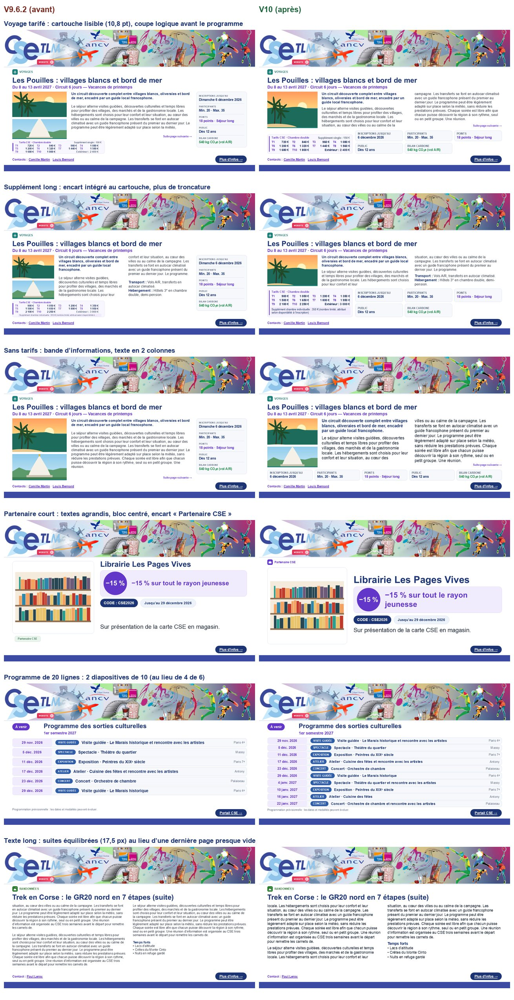
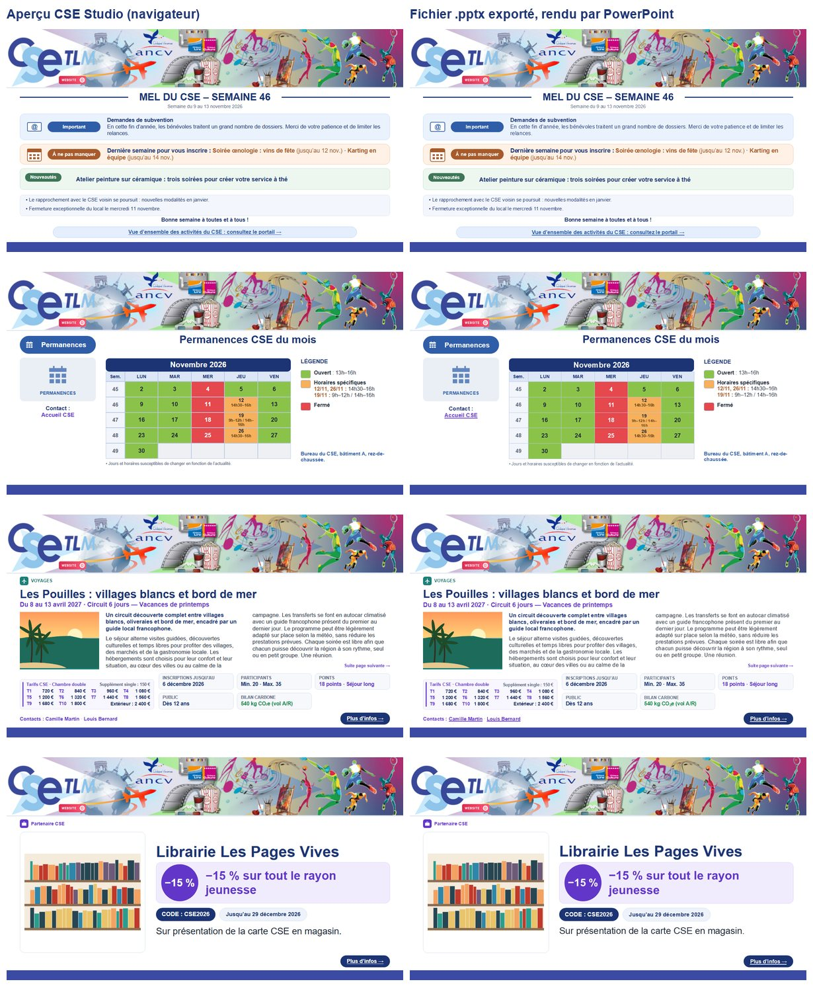
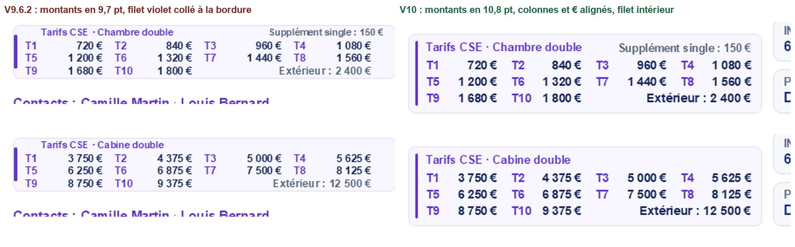
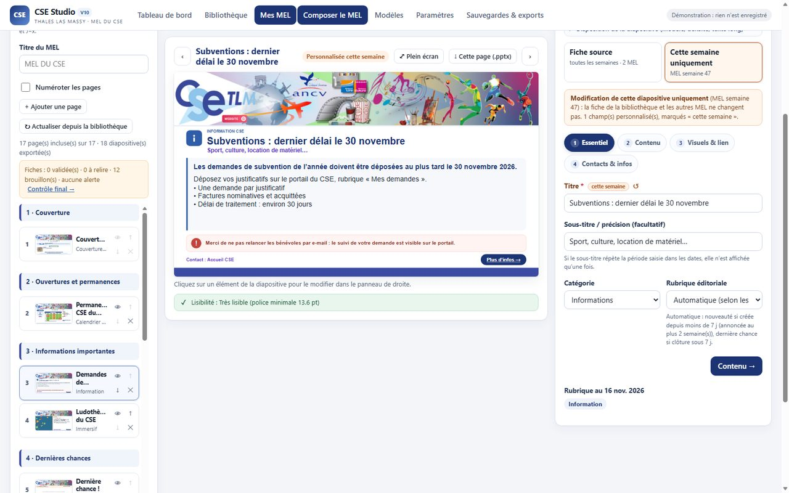

# CSE Studio V10 — version de référence pour le MEL hebdomadaire

*7 novembre 2026 · branche `feature/cse-studio-v10` · construite sur la V9.6.2 (`dfe6965`).*

La V10 fait de CSE Studio l'outil de travail hebdomadaire des bénévoles. Elle permet de :
- repartir du MEL de la semaine précédente, sans rien ressaisir ;
- modifier toutes les diapositives dans l'application ;
- obtenir une mise en page plus précise et plus économe en diapositives ;
- exporter des PowerPoint dont chaque photo annoncée est réellement intégrée.

Toutes les données V6 à V9.6.2 sont reprises sans perte.



---

## 1. Ce qui change pour les bénévoles

| Besoin | V10 |
|---|---|
| Préparer la semaine suivante | **Mes MEL → « Dupliquer vers la semaine suivante »** : couverture, permanences, informations permanentes, règlement, personnalisations et exclusions sont repris. Les rubriques sont recalculées à la nouvelle date et un **rapport de différences** s'affiche (conservées, déplacées, nouvelles, retirées, à vérifier). Le MEL précédent n'est jamais modifié. |
| Corriger une diapositive | **Composer le MEL** : 3 zones (pages, grand aperçu, propriétés). Un clic sur un élément de l'aperçu ouvre le bon champ. Deux portées clairement affichées : **« Fiche source (toutes les semaines) »** ou **« Cette semaine uniquement »** (tous les champs : textes, dates, photos, tarifs, contacts, lien, calendrier…). Chaque champ personnalisé porte un repère « cette semaine » et un bouton ↺ pour revenir à la fiche. |
| Archiver ce qui a été diffusé | Statuts **Brouillon → À relire → Validé → Publié (figé) → Archivé**. Un MEL publié est **figé** (instantané) : il reste consultable et exportable tel que diffusé, même si les fiches changent ensuite. |
| Éviter les nouveautés à répétition | Une nouveauté déjà annoncée n'est plus « nouveauté » au-delà de **N semaines** (réglage, 2 par défaut). |
| Vérifier avant d'exporter | **Contrôle final** : toutes les diapositives, alertes, photos, validations, ordre éditorial. Un bouton « Modifier » mène à chaque page. Export complet ou d'une sélection. |
| Photos | Chaque photo affiche son état : **Prête**, **Non importée** (lien Web bloqué par le site) ou **Introuvable**. Une photo non intégrable **bloque l'export**, sauf choix explicite « Exporter sans ces photos » (la mise en page se recalcule sans elles, jamais de cadre gris). Cadrage par point focal (clic sur l'image), mode « image entière », texte alternatif. |
| Annuler une erreur | **↶ / ↷** (Ctrl+Z / Ctrl+Y hors champ de saisie), sur les 30 dernières étapes de la session. |
| Fichiers exportés | `CSE_MEL_2026_Semaine_46.pptx`. Après génération, le fichier est **contrôlé** : nombre de diapositives et de photos présentes dans `ppt/media`. |

---

## 2. Installer la V10 sur GitHub Pages

1. **Avant tout** : dans l'application actuelle, *Sauvegardes & exports → Télécharger la sauvegarde (.json)*. Conservez ce fichier hors du dépôt public.
2. Fusionner la pull request `feature/cse-studio-v10` dans `main` (ou copier les fichiers de la branche à la racine du dépôt, en gardant l'arborescence).
3. Vérifier *Settings → Pages* : branche `main`, dossier `/(root)`. Attendre la fin du déploiement (onglet *Actions*).
4. Ouvrir `https://mgresset.github.io/CSE_Massy/` et forcer l'actualisation (**Ctrl+Maj+R**). Le bandeau indique **V10** ; les fichiers sont servis avec `?v=10.0.0`.
5. Vos données sont reprises automatiquement : même clé `cse-studio-massy:v9:project`, même schéma, nouveaux champs facultatifs. Aucune migration destructive.

**Essai sans risque :** `https://mgresset.github.io/CSE_Massy/?demo=1` charge des données fictives sans rien enregistrer.

### Revenir à la V9.6.2 (retour arrière)

- **Code** : sur GitHub, ouvrir la pull request fusionnée et cliquer *Revert*, ou bien `git revert -m 1 <commit de fusion>` puis pousser. Le site V9.6.2 (`dfe6965`) est republié par GitHub Pages.
- **Données** : la V9.6.2 relit les données V10 : les champs inconnus sont conservés. Deux réserves :
  - les personnalisations autres que les 7 champs de texte V9.4 sont ignorées à l'affichage (elles restent stockées) ;
  - les sélections manuelles de plus de 6 activités dans une mosaïque sont ramenées à 6 au rechargement.

  En cas de doute, restaurez la sauvegarde JSON faite à l'étape 1 (*Sauvegardes & exports → Restaurer*, mode « Remplacer ») ; un instantané de sécurité est créé avant chaque remplacement.

---

## 3. Guide bénévoles (5 minutes)

1. **Créer ou mettre à jour une fiche** : *Bibliothèque → + Nouvelle fiche*. Le formulaire est guidé par étapes (Essentiel, Dates, Contenu, Visuels, Tarifs, Contacts). L'aperçu à droite est celui du PowerPoint.
   - **Dates** : la date de fin prend la date de début ; une date antérieure est refusée.
   - **Photos** : importez un fichier (JPG, PNG, WEBP), glissez-le, ou copiez une image sur un site puis collez-la (Ctrl+V) dans la zone prévue. Une adresse Web n'est acceptée que si le site autorise sa récupération ; sinon un message explique quoi faire.
2. **Créer le MEL de la semaine** : *Mes MEL → « Nouveau MEL à partir de la semaine N »*. Lisez le **rapport de différences** (points « À vérifier » en tête).
3. **Modifier les pages** : *Composer le MEL*. Cliquez une page à gauche, puis un texte dans l'aperçu.
   - Choisissez **« Fiche source »** pour corriger une fiche définitivement, ou **« Cette semaine uniquement »** pour une variante de ce numéro.
   - Couverture, mosaïques, programmes et règlement se modifient aussi dans le panneau de droite.
4. **Vérifier les images** : un badge rouge **« Non importée »** ou **« Introuvable »** signale une photo à remplacer (« Remplacer par un fichier » ou collage).
5. **Contrôle final puis export** : *✓ Contrôle final*, corrigez les points bloquants, puis *↓ Exporter le MEL (.pptx)*. Passez le statut à **Publié** une fois le MEL diffusé : il est alors figé.
6. **Canva** : bouton *↗ Ouvrir Canva*, puis importer le `.pptx` dans la présentation (*Créer → Importer*). Les textes restent modifiables.
7. **Sauvegarder** : *↓ Sauvegarde* (JSON avec photos) après chaque séance de travail, surtout avant de changer de poste.

---

## 4. Documentation technique

### 4.1 Modèle de données (compatible V9)

Le modèle est inchangé dans ses principes : clé `cse-studio-massy:v9:project`, schéma `cse-studio:v9`, images en IndexedDB (`img:<empreinte>`). Champs **ajoutés et facultatifs** :

| Objet | Champ | Rôle |
|---|---|---|
| Fiche | `photoMeta[ref] = { fit, fx, fy, alt, source }` | Cadrage (cover/contain), point focal 0–100 %, texte alternatif, adresse d'origine d'une image importée. |
| Page | `opts.override` + `opts.useOverrides` (format V9.4 étendu) | Valeurs propres à ce MEL pour **tous** les champs de `compose.OVERRIDE_FIELDS` (textes, dates, inscriptions, participants, contacts, photos et cadrage, tarifs, points, lien, offre partenaire, calendrier, catégorie, statut éditorial). Les objets et listes sont remplacés en bloc. |
| MEL | `status` | `draft`, `review`, `validated`, `published`, `archived`. |
| MEL | `snapshot` | Instantané à la publication : pages avec sélections automatiques matérialisées, copie des fiches utilisées, catégories, paramètres, historique des nouveautés. |
| MEL | `previousSnapshots` | Les 3 derniers instantanés, conservés après une réouverture en brouillon. |
| MEL | `newSeen[itemId] = date` | Date de première annonce d'une nouveauté, reportée de semaine en semaine. |
| MEL | `sourceIssueId`, `diffReport` | MEL d'origine d'une duplication et rapport de différences. |
| Paramètres | `newMaxWeeks` (2), `repoUrl`, `siteUrl`, `composerUrl` | Durée d'annonce des nouveautés et liens de référence. |

**Lecture d'une page :** `compose.effectiveItem(page, fiche)` produit la fiche telle qu'affichée dans ce MEL, et la fiche source n'est jamais modifiée. `setOverrides` enregistre la différence entre un brouillon de formulaire et la source ; `resetOverride` revient à la fiche, pour un champ ou pour toute la page.

### 4.2 Instantané (MEL publié) et duplication

- `compose.freezeIssue` est appelé au passage en « Publié ». Le rendu d'un MEL figé passe par `compose.issueView`, qui substitue les fiches, catégories et paramètres de l'instantané : le rendu et l'export restent identiques à la diffusion.
- `compose.duplicateIssue(projet, source, date)` :
  1. copie les pages (nouveaux identifiants) avec leurs personnalisations, modèles, densités, exclusions et retraits ;
  2. reporte l'historique des nouveautés ;
  3. retire les activités expirées, closes ou annulées ;
  4. ajoute les fiches nouvelles de la semaine (`refreshPreservingEdits`, non destructif) ;
  5. rétablit l'ordre éditorial ;
  6. produit le rapport : conservées, déplacées, ajoutées, retirées, exclues, à vérifier (calendrier d'un mois passé, personnalisation reprise, fiche modifiée depuis la publication, photo non intégrable), nouveautés échues.
- Le classement (`compose.classify(fiche, date, réglages, MEL)`) se fait toujours à la **date de référence du MEL** (Europe/Paris, dates civiles, sans décalage UTC).

### 4.3 Moteur de composition

- **Jetons de conception** (`layout.T`) : marges 40 px, contenu 186–590 px, espacements, rayons et tailles. Une unité vaut 1 px de diapositive (1 200 × 675), soit **0,8 pt** dans PowerPoint.
- **Seuils** : corps ≥ 15 px (**12 pt**) en mode automatique et aéré ; ≥ 13,75 px (**11 pt**) uniquement en densité **Compacte**, choisie explicitement. Titres ≥ 28 px (22,4 pt). Libellés ≥ 12,5 px (10 pt).
- **Activité classique** : les blocs vides disparaissent avant le calcul. Deux familles de compositions sont comparées :
  - **bande basse** : photos à gauche, texte en 1 ou 2 colonnes, puis cartouche tarifs en bas à gauche et cartes d'informations à sa droite (ou en colonne) ;
  - **colonne gauche** : photos au-dessus du cartouche, texte et informations à droite.

  Chaque candidat reçoit la plus grande taille de corps qui tient (recherche dichotomique) et un score : lisibilité, remplissage, longueur de ligne, taille et proportions de la photo, espace perdu.
- **Suites** : uniquement si rien ne tient à 12 pt.
  - Coupe de préférence avant le premier intertitre (« Programme », « Temps forts »).
  - Le nombre total de diapositives est minimisé.
  - Quand plusieurs suites sont nécessaires, le texte est **réparti à parts égales**.
  - Si la densité Compacte tiendrait sur une diapositive, l'application le **propose** sans l'imposer.
- **Typographie** : un paragraphe vide vaut **une demi-ligne** (`metrics.PARA_GAP`), dans l'aperçu (hauteur CSS) comme dans PowerPoint (interligne exact par paragraphe). Les coupures de lignes sont mises en cache par paragraphe.
- **Cartouche T1–T10** (`layout.priceGrid`) : géométrie déterministe calculée sur les métriques Arial.
  - Grille 4 / 4 / 2 : chaque colonne commence au même x (T1/T5/T9…) ; les montants sont alignés à droite sur le même bord, donc les € s'alignent.
  - « Extérieur » occupe les colonnes 3–4 de la dernière ligne, aligné sur le bord des montants.
  - Le filet violet est intérieur, avec des marges haut et bas égales (8 px).
  - Supplément court : en tête à droite (la grille s'élargit si besoin pour garder l'alignement). Supplément long : encart interne, renvoyé à la ligne, jamais tronqué.
  - Le cartouche disparaît sans réserver de place quand les tarifs sont désactivés.
  - Tailles : montants 13,5 px (10,8 pt), extérieur 14 px (11,2 pt) ; la V9.6.2 était à 12,1 px (9,7 pt).
- **Contrôles géométriques** (`layout.auditSlide`, appliqués à chaque diapositive) : élément hors cadre, textes qui se chevauchent (boîtes d'encre réelles), corps sous le seuil, photo non intégrable. Les alertes sont affichées dans l'aperçu et reprises au contrôle final.

### 4.4 Aperçu = export

L'aperçu HTML et le PowerPoint partagent la même liste d'éléments calculés : coordonnées, tailles, interlignes exacts, couleurs, liens et recadrage. Textes, formes et pictogrammes (formes libres) restent **modifiables** dans PowerPoint et Canva. Les photos sont recadrées au point focal puis **embarquées** dans `ppt/media`. Le bandeau officiel est placé une seule fois dans le masque, en JPEG d'origine.

**Parité mesurée** sur les 28 diapositives des cas de référence (rendu Edge contre rendu Microsoft PowerPoint, zone sous le bandeau) :
- coupures de lignes identiques partout ;
- écart moyen de 9,4/255 ;
- différences dues à l'anticrénelage du texte et à une dérive verticale de PowerPoint d'environ 0,1 px par ligne, soit au plus 2 px sur une colonne pleine, sans effet sur la lisibilité ni sur les débordements.



### 4.5 Images : pipeline unique

1. **Sources** : fichier, glisser-déposer, collage (presse-papiers) ou adresse Web directe.
2. **Contrôle** : signature binaire réelle (JPEG, PNG, WEBP, GIF), sans se fier à l'extension ; 25 Mo au maximum.
3. **Stockage** : redimensionnement (1 800 × 1 400 px maximum), compression JPEG 0,84 ; PNG conservé s'il est transparent ; WEBP/GIF convertis. Copie locale IndexedDB dédupliquée par empreinte.
4. **Adresse Web** : `fetch` en CORS. En cas d'échec, une sonde `` distingue l'image affichable mais **bloquée par CORS** d'une adresse cassée. Erreurs explicites :
   - `cors` ;
   - `http` (404…) ;
   - `html` (page Web) ;
   - `notimage` ;
   - `unreachable`.

   **Aucun proxy tiers.**
5. **États** (`images.status`) : `ready`, `remote` (lien Web non importé, non intégrable), `missing`. L'aperçu montre **la même ressource** que l'export. Une photo non prête apparaît comme une erreur rouge, jamais comme un cadre gris neutre.
6. **Export** : un contrôle préalable bloque l'export si une photo n'est pas prête. L'alternative explicite est de recomposer sans ces photos. Après génération, `pptx.verify` compte les diapositives et les médias de l'archive.
7. **Sauvegardes** : les images des fiches, de la corbeille, des personnalisations et des **instantanés publiés** sont incluses dans le JSON.
8. **Nettoyage** : *Sauvegardes & exports → Nettoyer les images inutilisées*. Il n'efface jamais une image encore utilisée, en particulier par un MEL publié.

**Limite honnête :** un site GitHub Pages ne peut pas contourner la protection CORS d'un autre site. Si l'import automatique depuis des sites qui refusent CORS devenait indispensable, il faudrait une **fonction serveur facultative contrôlée par le CSE**, non fournie. Elle devrait comporter :
- une liste de domaines autorisés ;
- une vérification du type et du poids ;
- une protection SSRF (pas d'adresse interne, redirections contrôlées) ;
- une authentification, des quotas et une journalisation minimale.

Elle ne serait jamais nécessaire pour l'import de fichiers ni pour l'usage normal.

### 4.6 Canva et Supabase

- **Canva** : bouton « Ouvrir Canva » (lien configurable, `https://canva.link/rewv8gx5iilr8kz` par défaut), puis import du `.pptx` exporté.
  - Un lien `canva.link` **ne permet pas** d'ajouter des pages automatiquement. Cela supposerait une intégration Canva autorisée (OAuth ou application de service) et un serveur sécurisé.
  - La fonction `supabase/functions/canva-publish` reste **expérimentale et non branchée**.
- **Supabase** (facultatif) : inchangé depuis la V9.2 (rôles Rédacteur / Relecteur / Administrateur, RLS, conflits conservés localement).
  - Les MEL V10 transportent leurs statuts et instantanés dans la même charge JSON.
  - **Non testé sur une instance réelle** : seul le faux serveur des tests l'a été.

### 4.7 Performances mesurées

- **Calcul de mise en page (Node)** :
  - 21 pages / 28 diapositives des cas de référence en 268 ms ;
  - MEL témoin de 33 diapositives en 447 ms ;
  - 70 diapositives en 610 ms.
- **Export dans le navigateur** (Edge) : MEL de démonstration de 20 diapositives et 15 photos, 1,2 Mo, en 0,9 s.
- **Compositeur** : les miniatures sont mises en cache par page. Une saisie ne recalcule que la page en cours ; la liste complète n'est recalculée que si son nombre de diapositives change.

---

## 5. Rapport de tests

Tous les résultats ci-dessous ont été obtenus sur cette branche le 7 novembre 2026, avec Node 24.14 et Windows 11. Ils ne sont pas extrapolés.

| Suite | Résultat |
|---|---|
| Avant modification (`node tests/run.js` sur la V9.6.2) | **22 fichiers, tous réussis.** |
| `node tests/run.js` (V10) | **23 fichiers, tous réussis**, dont `v10.test.js` (29 vérifications). Les tests V9.x qui figeaient les cotes du cartouche V9.x (hauteur ≤ 67 px, police 9,7 pt) ont été adaptés aux règles V10 (≤ 92 px pour 3 rangées en 10,8 pt), sans changer leur intention. |
| `tests/v10.test.js` | A01, A03, A04, A05, A06 (×3), A09/A10 ; sélection manuelle 24 activités ; B01–B16 (cartouche : alignements de colonnes et des €, extérieur, filet, insécables ; supplément court et long ; grands montants ; tarifs désactivés ; demi-ligne aperçu/PPTX ; titre long + Nouveauté sans collision ; partenaire court ; mosaïques de 1 à 6 cartes ; programme de 20 lignes ; règlement long ; **13 modèles sans élément hors cadre ni texte superposé**) ; C05, C07, C09, C10 ; D04, D05 ; E01 ; A12 (**MEL de 70 diapositives**, archive contrôlée : diapositives et médias). |
| `tests/e2e/ui-check.js` (Edge sans affichage, vrai navigateur) | **12 vérifications réussies**, sans erreur JavaScript : Mes MEL, duplication et rapport (A05), MEL source intact, clic aperçu → champ, personnalisation « cette semaine » (A03), ordre éditorial (A10), contrôle final, photo non importée signalée et export bloqué (C05), dates (D01), calendrier sans saut de défilement (D02). |
| Navigateur intégré (essais manuels scriptés) | <ul><li>Export complet : 20 diapositives et 15 photos vérifiées dans l'archive.</li><li>Photo Web non importée : l'export s'arrête ; avec « sans ces photos », la composition est refaite et l'archive ne contient aucun cadre d'erreur.</li><li>Serveur `tests/cors-server.js` : image avec CORS importée (C04), image bloquée par CORS expliquée (C05), réponse 404, page HTML et faux JPEG refusés (C06), PNG transparent conservé (C02).</li><li>Collage : image prête, toujours présente après rechargement, puis intégrée au PPTX (C01, C03).</li></ul> |
| Rendus Microsoft PowerPoint (COM) | 28 diapositives de référence et MEL témoin de 33 diapositives (13 modèles) ouverts sans erreur, PNG produits, parité mesurée (§ 4.4). |

**Non testé ou à tester manuellement :**
- l'import réel du `.pptx` dans Canva ;
- Supabase sur une vraie instance multi-utilisateur ;
- LibreOffice ;
- Firefox et Safari ;
- tablettes et téléphones ;
- une photo de téléphone avec orientation EXIF (le navigateur l'applique, ce qui n'a pas été vérifié avec un vrai fichier) ;
- un collage depuis un site réel (le test utilise un événement de collage simulé avec un vrai fichier) ;
- la restauration d'une sauvegarde sur un second ordinateur (vérifiée par les tests de migration et de sauvegarde, pas sur un autre poste).

---

## 6. Inventaire des modifications

| Fichier | Modifications |
|---|---|
| `js/engine/layout.js` | Jetons de conception ; cartouche tarifs déterministe ; cartes d'informations en grille (libellés et valeurs mesurés) ; état des images et erreur visible ; point focal et texte alternatif ; contrôles géométriques ; libellés ≥ 10 pt. |
| `js/engine/templates.js` | Activité classique réécrite (compositions comparées, score, coupe logique, minimum de diapositives, suites équilibrées) ; partenaire (échelle et centrage) ; programmes (pagination équilibrée, 10 lignes par diapositive) ; règlement (« Suite » sans chevauchement) ; calendrier (horaires ≥ 9,6 pt, pictogramme sans photo) ; immersif agrandi pour les textes courts ; personnalisations de tous les champs ; MEL figé ; proposition « Compacte » ; correction d'un appel `M()` non défini. |
| `js/engine/metrics.js`, `render-html.js`, `js/export/pptx.js` | Demi-ligne entre paragraphes ; cache des coupures ; aperçu cliquable ; recadrage au point focal ; texte alternatif ; vérification `ppt/media`. |
| `js/core/compose.js` | Personnalisation par page (tous les champs), statuts, instantané, vue figée, duplication et rapport, historique des nouveautés, audit des images. |
| `js/core/model.js` | Nouveaux champs facultatifs ; sélections manuelles jusqu'à 24 (auparavant 6) ; lignes de programme jusqu'à 120. |
| `js/core/images.js` | États, diagnostics CORS / HTTP / HTML / faux fichier, signature binaire, nettoyage, images des instantanés et personnalisations dans les sauvegardes. |
| `js/core/store.js` | Annuler / rétablir par points de contrôle regroupés. |
| `js/app/composer.js` | Compositeur 3 zones, portée fiche / semaine, options de toutes les pages, ordre des cartes, rendu ciblé. |
| `js/app/editor.js` | Formulaire réutilisable (`App.itemForm`) ; repères « cette semaine » et ↺ ; état et cadrage des photos ; plages de dates par jour de semaine. |
| `js/app/issues.js` (nouveau) | Mes MEL, nouveau MEL, duplication, rapport, statuts, contrôle final, export sélectif. |
| `js/app/main.js`, `views.js`, `ui.js`, `css/*.css`, `index.html`, `mel.html` | Contrôle d'export, noms de fichiers, ↶ ↷, routes, paramètres (`newMaxWeeks`, liens de référence), nettoyage des images, styles V10, cache `10.0.0`. |
| `tests/` | `v10.test.js`, `e2e/ui-check.js`, `cors-server.js`, `fixtures/v10-cases.js`, `fixtures/v10-demo.js`, `export-v10-cases.js`, `export-v10-demo.js`, planche `visual.html?set=v10` déterministe. |

**Défauts V9.6.2 corrigés et vérifiés** :
- cartouche en 9,7 pt et filet collé à la bordure ;
- supplément long tronqué ;
- continuation presque vide (voyage) ;
- dernière diapositive presque vide (texte long) ;
- programme de 20 lignes sur 4 diapositives ;
- partenaire court avec grand vide ;
- « Suite page suivante » sur le bouton du règlement ;
- horaires du calendrier en 8,4 pt tronqués ;
- sélection manuelle tronquée à 6 au rechargement ;
- export arrêté à la première photo Web, sans liste des photos concernées ni possibilité d'exporter sans elles.

---

## 7. Limites non résolues (déclarées)

- **Contenu très dense** (voyage avec description, programme sur 6 jours, 5 informations, 10 tarifs et 2 photos) : il ne tient pas sur une diapositive à 12 pt, même en densité Compacte. La V10 produit une suite propre, coupée avant le programme, plutôt que de descendre sous le seuil. Raccourcir le texte ou passer le programme dans une autre fiche permet de revenir à une diapositive.
- **Placement manuel des blocs** (glisser un bloc dans une zone autorisée) : non proposé. La mise en page reste calculée, pour garantir les alignements et l'absence de débordement. Les leviers sont le modèle, la densité, la suite, le cadrage des photos et la personnalisation des contenus.
- **Édition du texte directement dans l'aperçu** : non proposée. Un clic dans l'aperçu ouvre le champ correspondant.
- **Rotation manuelle des photos** : non proposée. L'orientation EXIF est appliquée par le navigateur.
- **Annuler / rétablir** : 30 étapes, en mémoire pour la session en cours ; un rechargement repart de l'état enregistré.
- **Validation des fiches** : indicative en mode local. Une validation sécurisée nécessite Supabase et ses rôles.
- **Barème T1–T10** (70 % → 25 %) : valeurs de départ à faire confirmer par le CSE.
- **Canva, Supabase réel, images bloquées par CORS** : voir § 4.5 et § 4.6.

---

## 8. Captures de contrôle

- Avant / après : `docs/v10-avant-apres.jpg` ; cartouche tarifs : `docs/v10-cartouche-tarifs.jpg`.
- Parité aperçu / PowerPoint : `docs/v10-parite-apercu-pptx.jpg`.
- MEL témoin (33 diapositives fictives, 13 modèles, rendu PowerPoint) : `docs/v10-mel-temoin-planche.jpg`. Fichier modifiable : `docs/demo/CSE_MEL_2026_Semaine_46_DEMO.pptx`.
- Interface (captures du parcours réel dans Edge) :
  - `docs/v10-interface-mes-mel.jpg` ;
  - `docs/v10-interface-rapport.jpg` ;
  - `docs/v10-interface-compositeur.jpg` ;
  - `docs/v10-interface-controle-final.jpg` ;
  - `docs/v10-interface-photos.jpg` ;
  - `docs/v10-interface-calendrier.jpg`.




### Reproduire les contrôles

```bash
node tests/run.js
```

```bash
node tests/e2e/ui-check.js captures
```

```bash
node tests/export-v10-demo.js CSE_MEL_demo.pptx
```

Planche visuelle des cas de référence : `tests/visual.html?set=v10`.
