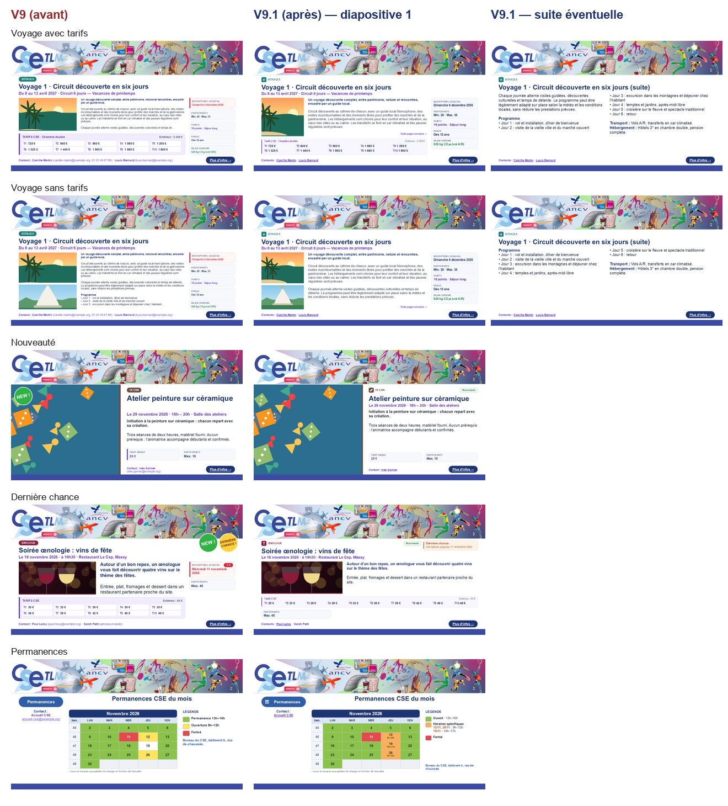
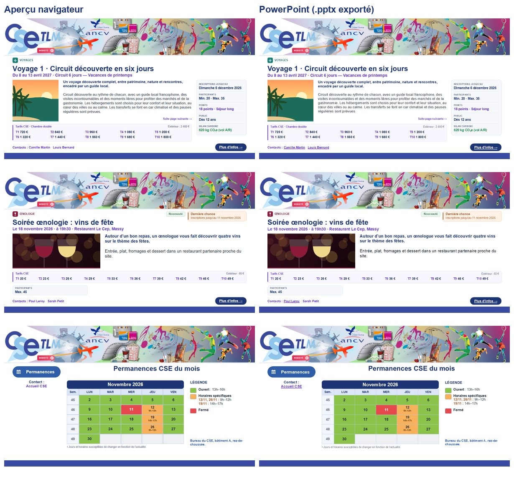

# Notes de version

## V9.2 — Stabilisation du partage Supabase (7 novembre 2026)

**Aucune modification du rendu des diapositives ni du moteur tarifaire.**

- **Premier raccordement** : si une fiche locale partage l’identifiant métier `payload.id` avec une fiche existante sur Supabase, les deux sont rattachées sans création supplémentaire. Si leurs contenus divergent, la version locale est sauvegardée comme copie de conflit dans la bibliothèque ; la version distante est affichée dans la fiche d’origine. Les photos `img:` et les photos encodées sont comparées avec leur contenu quand celui-ci est disponible.
- **Conflits MEL** : une version locale divergente est copiée sous un nouvel identifiant **avant** d’appliquer la version distante. La copie figure dans « Composer le MEL » avec la mention « COPIE LOCALE EN CONFLIT » et n’est **jamais publiée automatiquement**. Le bénévole peut la consulter et autoriser explicitement son partage comme nouveau MEL depuis « Paramètres → Espace partagé ».
- **Conflits de paramètres** : les paramètres et catégories locaux sont conservés dans `project.cloud.settingsBackups` (10 versions au maximum). Dans les paramètres de l’espace partagé, le bouton « Restaurer ici » rétablit la copie sur cet appareil après création d’un instantané de sécurité.
- **Conflit de version au moment d’un PATCH** : si l’écriture est refusée, les modifications locales restent sur cet appareil. La synchronisation suivante peut les comparer avec la nouvelle version distante.
- **Sécurité** : aucune copie de récupération n’est envoyée à Supabase sans action explicite ; les règles RLS serveur ne changent pas.
- **Récupération** : avant de tester le partage, exportez une sauvegarde JSON complète depuis « Sauvegardes & exports ». Les données locales restent sous la clé V9 existante : aucune migration destructive.
- **Tests** : `node tests/run.js` (10 fichiers), dont `cloud-regressions.test.js` : attachement identique ou divergent, copies de MEL, premier raccordement, paramètres, persistance et absence de publication implicite. Exécution réelle contre une instance Supabase et essais à plusieurs navigateurs encore requis avant déploiement collectif.

## V9.1 — Refonte graphique adaptative (novembre 2026)

**Objectif : des diapositives plus lisibles et plus sobres, une diapositive supplémentaire plutôt qu’une diapositive illisible.**

### Diapositives

- **Lisibilité garantie** : corps de texte **≥ 12 pt** (15 px de diapositive), cible 14–16 pt (17,5–20 px). La correspondance est de 1 px de diapositive = 0,8 pt PowerPoint.
  - Le mode « compact » réduit la taille visée, jamais le minimum.
  - L’alerte à 10 pt de la V9 a disparu.
- **Composition adaptative** (modèles Classique, Immersif, Information). Le moteur compare plusieurs dispositions et retient la plus lisible :
  - photo de 200 à 420 px, ou panneau décoratif ;
  - une ou deux colonnes équilibrées ;
  - infos pratiques en colonne ou en bande ;
  - tarifs pleine largeur ou sous le texte.
- **Suite automatique** : si le contenu ne tient pas à 12 pt, la fiche continue sur une diapositive « (suite) ». Le texte est coupé entre paragraphes ou avec au moins 2 lignes de chaque côté, en deux colonnes.
  - L’éditeur affiche « Contenu trop long — N diapositives générées ».
  - Dans le MEL, chaque page propose « Texte long : automatique / toujours 2 diapositives / jamais ». Le mode « jamais » tronque visiblement et le signale.
  - Les descriptions ne reçoivent plus de « … » automatique.
- **Tarifs T1–T10 en bandeau compact** : une ligne de dix montants si la largeur le permet, sinon 2 × 5, fond très clair, accent fin. « Extérieur » apparaît en mention discrète.
  - Un prix unique devient une petite ligne d’information.
  - Sans tarif, aucune zone n’est réservée.
  - Les calculs sont inchangés.
- **En-tête rééquilibré** :
  - catégorie avec pictogramme, puis titre et date sur toute la largeur, juste sous le bandeau ;
  - infos pratiques en liste compacte, ou en bande quand il n’y en a qu’une ou deux.
- **Statuts sobres** :
  - « Nouveauté » : petite étiquette vert pastel (#EAF5ED / #3E7657 / #C6E0CE) ;
  - « Dernière chance » : petit encart orange pastel (#FFF1E5 / #A75B2C / #F1C9A8) avec « Inscriptions jusqu’au [date] » ;
  - les deux coexistent sans chevauchement, l’urgence étant prioritaire ;
  - sans date limite, aucune date n’est inventée ;
  - fin des pastilles « NEW ! » et « LAST CHANCE » inclinées.
- **Mosaïques** : bandeau pastel, étiquettes miniatures alignées avec la catégorie, jamais posées sur les photos. Le compteur J−x reste sur les cartes « Dernière chance ».
- **Pictogrammes de catégorie vectoriels** : même tracé en SVG dans l’aperçu et en forme libre PowerPoint, sans emoji ni police d’icônes.
  - La correspondance automatique tolère pluriels et accents.
  - Une icône générique est utilisée pour les catégories personnalisées.
  - Le choix est réglable dans Paramètres → Catégories.
- **Contacts** :
  - seul le nom est affiché, et chaque nom ayant un e-mail valide est un **lien `mailto:` distinct**, dans l’aperçu comme dans le PowerPoint ;
  - un e-mail invalide reste non cliquable et l’éditeur le signale discrètement ;
  - le formulaire ne demande plus que nom et e-mail ; les téléphones et fonctions des versions précédentes sont conservés sans être affichés ;
  - l’adresse reste lisible dans la cible du lien : elle n’est pas secrète.
- **Permanences** :
  - trois états : **Ouvert** (vert, horaire standard), **Horaire particulier** (orange, horaire libre par jour, affiché dans la case) et **Fermé** (rouge) ;
  - la légende est générée à partir des jours réellement utilisés, avec les horaires identiques regroupés (`05/11, 19/11 : 9h–12h`) ;
  - dans l’éditeur, on choisit l’état puis on clique sur les jours, et chaque horaire particulier reste modifiable ;
  - les calendriers V9 sont repris automatiquement, et leurs anciens libellés conservés.

### Corrections issues de l’audit précédent

- **Sauvegarde JSON** : les images des fiches placées dans la corbeille sont désormais incluses.
- **Synchronisation Supabase** :
  - une modification faite pendant un envoi n’est plus marquée « synchronisée » à tort ; elle est renvoyée à la synchronisation suivante ;
  - les mises à jour reçues sont appliquées sans remplacer l’objet ouvert dans l’éditeur.

### Tests

`node tests/run.js` lance 9 fichiers, dont `tests/v91.test.js`, qui couvre les critères d’acceptation suivants :

- tarifs présents, absents ou prix unique ;
- textes de 120, 400 et 900 mots ;
- corps ≥ 12 pt ;
- titres et statuts ;
- 0, 1 ou 3 contacts avec `mailto:` ;
- pictogrammes ;
- permanences avec horaires dédoublonnés ;
- mosaïques à 1, 3 et 6 cartes ;
- export d’un MEL de 65 diapositives.

Les captures de parité ont été faites ainsi :

1. rendu des cas `tests/fixtures/v91-cases.js` par Edge (aperçu) et par Microsoft PowerPoint (PPTX exporté) ;
2. résultat : mêmes coupures de lignes et écart moyen de 6/255, principalement le soulignement des liens que PowerPoint ajoute d’office.

### Compatibilité

- **Données** : les données V9 sont conservées, notamment les contacts (`phone`, `role`), les calendriers (`statuses`), les sauvegardes JSON et la clé `cse-studio-massy:v9:project`. La valeur `split: true` d’une page devient « toujours 2 diapositives ».
- **Fonctions** : les 13 modèles, les catégories, les tarifs et points, la bibliothèque, l’export PPTX et le bandeau d’origine sont inchangés.

## V9 — Modèle unifié (novembre 2026)

Voir le README : bibliothèque unique, moteur commun aperçu/PPTX, compositeur du MEL, migration V6–V8, Supabase facultatif.
