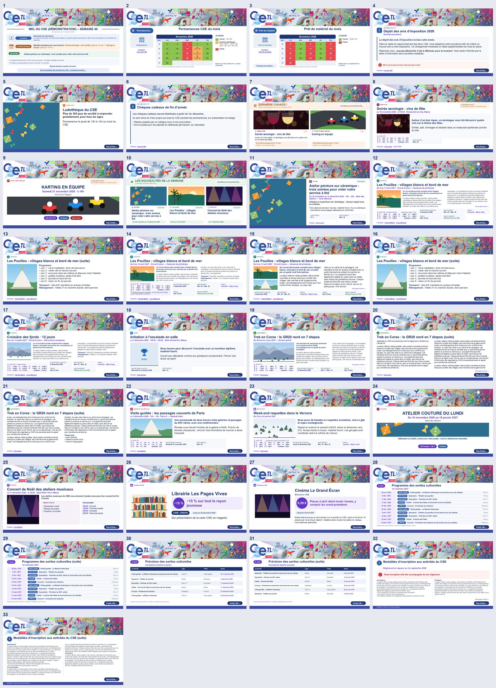
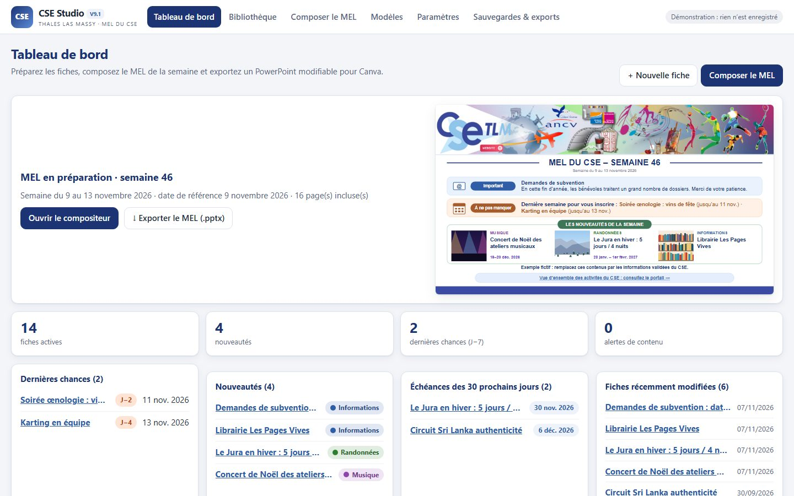
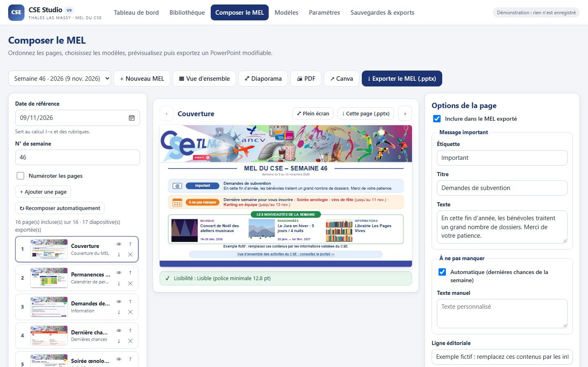
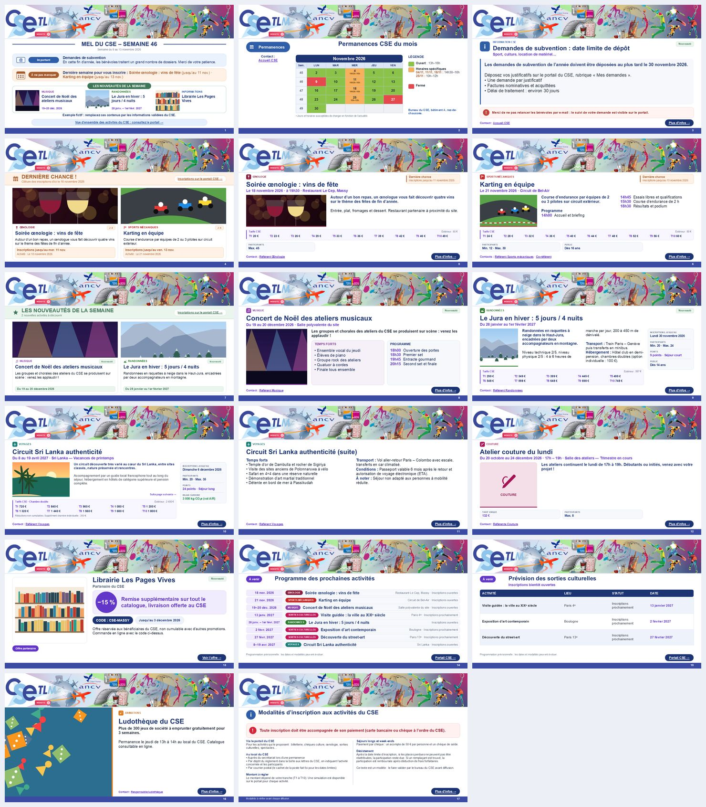

# CSE Studio V10 — MEL hebdomadaire du CSE Thales LAS Massy

**Version actuelle : V10 (7 novembre 2026).** Application statique pour GitHub Pages : bibliothèque de fiches, composition du MEL hebdomadaire en dix rubriques fixes, édition de toutes les diapositives, export PowerPoint modifiable (importable dans Canva), sauvegardes JSON avec photos. Les données V6 à V9.6.2 sont reprises sans perte.

- **Site** : https://mgresset.github.io/CSE_Massy/ · **Compositeur** : https://mgresset.github.io/CSE_Massy/mel.html · **Démonstration sans enregistrement** : https://mgresset.github.io/CSE_Massy/?demo=1
- **Nouveautés V10, guide bénévoles, documentation technique, rapport de tests, limites et retour arrière** : [MISE_A_JOUR_V10.md](MISE_A_JOUR_V10.md)
- **Notes de version** : [NOTES-VERSION.md](NOTES-VERSION.md)

| Chaque semaine | Où |
|---|---|
| Créer le MEL à partir de la semaine précédente (rien n'est ressaisi, le précédent reste intact) | *Mes MEL → Nouveau MEL à partir de la semaine N* |
| Corriger n'importe quelle diapositive, pour toutes les semaines ou pour cette semaine uniquement | *Composer le MEL* (clic sur l'aperçu → champ) |
| Vérifier photos, textes, validations et ordre | *✓ Contrôle final* |
| Exporter `CSE_MEL_AAAA_Semaine_NN.pptx` puis l'importer dans Canva | *↓ Exporter le MEL* · *↗ Ouvrir Canva* |
| Figer le MEL diffusé | Statut *Publié (figé)* |



Tests : `node tests/run.js` (23 fichiers) · parcours navigateur : `node tests/e2e/ui-check.js` · MEL témoin : `node tests/export-v10-demo.js`.

---

## Historique (V9.x)

### CSE Studio V9.6.2

Corrections du rendu des images dans les PowerPoint et finitions graphiques des fiches activités. Voir `MISE_A_JOUR_V9_6_2.md`.

# CSE Studio V9.6 — Finition visuelle et fiabilisation

**Version actuelle : 9.6 (7 novembre 2026).** Application statique à publier sur GitHub Pages, sans changement de structure des sauvegardes V9.5.2.

Les **20 suites de tests** passent. Les améliorations comprennent l'alignement des tranches, la suppression des doublons de dates, l'équilibrage des fiches sans photo et partenaires, des pages de planning plus lisibles, ainsi que des corrections de pagination pour les règlements volumineux.

Voir **[MISE_A_JOUR_V9_6.md](MISE_A_JOUR_V9_6.md)** pour la liste des changements et la procédure de mise à jour. L'accès à Canva reste manuel par export PowerPoint ; aucune insertion automatique n'est revendiquée.

---


## V9.5.2
- Affinage visuel du cartouche Tarifs CSE : alignement colonne par colonne et barre violette corrigée.
n## V9.5.1
- Cartouche tarifs plus compact et alignement amélioré des montants.

# CSE Studio V9.5 — Éditeur d'activités et compositeur du MEL

**Historique : V9.5 (7 novembre 2026).** Application statique pour GitHub Pages : bibliothèque d'activités réutilisables, composition des MEL selon dix rubriques fixes, retouches propres à un MEL, treize modèles, tarifs CSE facultatifs T1 à T10, export PowerPoint modifiable et sauvegardes JSON.

Cette version améliore la fiabilité, la navigation et les contrôles avant export sans modifier les données enregistrées. Voir **[MISE_A_JOUR_V9_5.md](MISE_A_JOUR_V9_5.md)** pour les changements, les tests et l'installation.

---

# CSE Studio V9.4.5 — Cartouche tarifs compact et harmonisé

Le cartouche de la fiche Classique ne mesure plus que **465 px de largeur** sur les 1 200 px de la slide. Les dix tarifs s’affichent sur trois rangées (4/4/2). Voir `MISE_A_JOUR_V9_4_2.md`.


## V9.4.1 — Cartouche des tarifs T1–T10

Sur les fiches **Activité classique**, les dix tarifs sont maintenant répartis en deux lignes de cinq dans un rectangle discret, aligné en bas à gauche (largeur maximale 610 px). Les prix extérieurs et suppléments restent visibles. Les tarifs facultatifs ne réservent aucun espace lorsqu’ils sont désactivés. Voir `MISE_A_JOUR_V9_4_1.md`.

# CSE Studio V9.4 — Ordre éditorial et diapositives modifiables

## Nouveautés V9.4 — Composer un MEL sans perdre les personnalisations

- **10 rubriques fixes** : 1. Couverture, 2. Ouvertures et permanences, 3. Informations importantes, 4. Dernières chances, 5. Nouveautés, 6. Inscriptions en cours, 7. Annonces et événements, 8. Partenaires, 9. Plannings et prochaines activités, 10. Règlement. Une rubrique sans page n'est pas affichée.
- **Couverture obligatoire** : première diapositive conservée, non supprimable et non excluable ; les calendriers de permanences se rangent automatiquement juste après.
- **Tri interne** : déplacements à la souris ou avec les flèches au sein de la même rubrique ; impossible de désorganiser le classement principal.
- **Affectation dédiée aux annonces** : dans « Fiche → Essentiel → Placement dans le MEL », choisir *Annonces / concerts / événements* (ou la rubrique voulue). Cela ne change pas la catégorie.
- **Retouches de diapositive** : depuis le compositeur, le bouton « Modifier la fiche » renvoie à la fiche source puis retourne à la page. Dans « Options de la page », « Personnaliser uniquement cette diapositive » permet de changer titre, sous-titre, résumé, description, temps forts, programme et remarques pour **ce MEL uniquement**. Les autres MEL et la fiche source restent inchangés.
- **Actualisation non destructive** : « Actualiser sans perdre mes modifications » ajoute les nouvelles activités de la bibliothèque, réordonne les rubriques et **conserve** les ID, options, textes surchargés, exclusions et pages insérées manuellement. Les pages retirées ne sont pas réintroduites automatiquement : un ajout explicite permet de les récupérer.
- **Compatibilité JSON V9.1/V9.2/V9.3** : champs optionnels `melSection`, `pages[].opts.useOverrides`, `pages[].opts.override` et `issue.suppressed` ; l'ancien contenu est conservé.
- **Github Pages** : application statique, aucun serveur supplémentaire.

### Utilisation recommandée

1. Saisir et mettre à jour les fiches dans « Bibliothèque ».
2. Pour les concerts et événements, sélectionner « Placement dans le MEL : Annonces ».
3. Dans « Composer le MEL », créer le MEL ou cliquer sur « Actualiser sans perdre mes modifications ».
4. Relire les dix rubriques ; adapter les textes d'une seule diapositive dans les options de page ou modifier la fiche source.
5. Exporter le PowerPoint en conservant les liens.

### Tests V9.4

`node tests/run.js` : 13 suites comprenant les tests V9.4 de l'ordre éditorial, du retour à l'édition, des surcharges de texte isolées, de la préservation des pages modifiées et du retrait persistant. Le rendu interactif dans le navigateur doit être validé une fois déployé sur GitHub Pages.


Cette version est construite sur la **V9.2** et conserve les corrections de synchronisation ainsi que les sauvegardes locales. Elle répond aux retours d’utilisation sur les voyages, permanences, partenaires, règlements et couvertures.

Consultez `NOTES_V9_3.md` pour le détail des changements, les limites CORS et la procédure de déploiement.

**Important :** ne collez jamais une clé privée Supabase ou des données internes dans un dépôt public. Effectuez une sauvegarde JSON avant de remplacer les fichiers. La publication automatique dans Canva n’est pas activée.

---

# CSE Studio V9.2 — fiches d’activités et MEL hebdomadaire du CSE Thales LAS Massy

Application web statique (aucun serveur requis) publiée sur **GitHub Pages** :

- Application : `https://mgresset.github.io/CSE_Massy/`
- Composer le MEL : `https://mgresset.github.io/CSE_Massy/mel.html`
- Démonstration fictive sans rien enregistrer : `https://mgresset.github.io/CSE_Massy/?demo=1`

**Principe : chaque activité est saisie une seule fois dans la bibliothèque.** Le MEL de chaque semaine se compose ensuite automatiquement à partir de la date de référence : couverture, permanences, informations, dernières chances, nouveautés, activités en cours, partenaires, programmes à venir et règlement en fin de MEL. L’export PowerPoint (.pptx) est modifiable et s’importe dans Canva.

Up Expert / Kalidea reste l’outil des activités et des inscriptions. CSE Studio ne fait que préparer les supports de communication et ne collecte aucune donnée personnelle des bénéficiaires.

> **V9.2 — correctifs collaboratifs :** premier raccordement de fiches sans doublons lorsque l’identifiant métier existe déjà ; copies de MEL créées avant remplacement d’une version locale divergente ; copies non partagées automatiquement ; paramètres locaux en conflit sauvegardés et restaurables. Les tests dédiés sont dans `tests/cloud-regressions.test.js`. Voir [NOTES-VERSION.md](NOTES-VERSION.md).

> **Nouveau en V9.1** : diapositives plus lisibles (corps ≥ 12 pt, suite automatique sur une autre diapositive plutôt qu’un texte minuscule), tarifs en bandeau compact, statuts « Nouveauté » / « Dernière chance » sobres en pastel, pictogrammes de catégorie, contacts cliquables (`mailto:`) sans e-mail affiché, permanences avec horaires particuliers par jour et légende automatique. Détails et captures avant/après : [NOTES-VERSION.md](NOTES-VERSION.md).



## Sommaire

1. [Ce qui change en V9 et V9.1](#ce-qui-change-en-v9)
2. [Utilisation pas à pas](#utilisation-pas-à-pas)
3. [Les 13 modèles et l’auto-layout](#les-13-modèles-et-lauto-layout)
4. [Règles automatiques du MEL](#règles-automatiques-du-mel)
5. [Données, sauvegardes et migration V6–V8](#données-sauvegardes-et-migration-v6v8)
6. [Publication sur GitHub Pages](#publication-sur-github-pages)
7. [Tests](#tests)
8. [Espace partagé Supabase (facultatif)](#espace-partagé-supabase-facultatif)
9. [Canva : ce qui est possible et ce qui ne l’est pas](#canva--ce-qui-est-possible-et-ce-qui-ne-lest-pas)
10. [Architecture du code](#architecture-du-code)
11. [Limites connues](#limites-connues)

## Ce qui change en V9

- **Un seul modèle de données et un seul moteur de mise en page.** La V8 contenait deux applications (éditeur V6 et compositeur V8) avec deux formats de fiche : les activités étaient recopiées dans le MEL. En V9, une page du MEL **référence** une fiche. Une fiche corrigée l’est donc dans tous les MEL.
- **Aperçu identique au PowerPoint.** L’aperçu et le .pptx utilisent les mêmes calculs, la même police (Arial), la même taille (1 px = 0,8 pt), le même interligne exact et des marges nulles. Le texte est mesuré avec les vraies largeurs de caractères d’Arial. Le contrôle par PowerPoint donne les mêmes coupures de lignes (voir [docs/v9.1-parite-apercu-pptx.jpg](docs/v9.1-parite-apercu-pptx.jpg)).
- **Auto-layout réel.** Les blocs absents (photos, tarifs, points, contacts, informations pratiques) libèrent leur place : les colonnes s’élargissent, la police grandit, etc. Modes **Automatique / Aéré / Compact**.
  - **V9.1** : le corps de texte ne descend jamais sous **12 pt** (15 px de diapositive), même en mode compact ; la cible est de 14 à 16 pt.
  - Le moteur compare plusieurs compositions (largeur de photo, 1 ou 2 colonnes équilibrées, position des infos et des tarifs) et garde la plus lisible.
  - Si le texte ne tient pas, il continue sur une diapositive « (suite) » (réglage par page : automatique, toujours 2 diapositives, ou jamais). Il n’est **jamais coupé en silence** : en mode « jamais », on voit le « … », un cadre rouge dans l’aperçu, un avertissement, et une confirmation est demandée à l’export.
- **13 modèles** : couverture, calendrier, information, activité classique, immersif, essentiel/affiche, animation, nouveautés (mosaïque 1 à 6), dernières chances (J−x, accent orange pastel), partenaire, programme liste, programme tableau, règlement multi-pages.
- **Navigation simple** : Tableau de bord, Bibliothèque, Fiche (formulaire par étapes et aperçu en direct), Composer le MEL (glisser-déposer, inclure/exclure, plein écran), Modèles, Paramètres, Sauvegardes & exports.
- **Catégories éditables** :
  - « Informations » toujours en premier ;
  - création, changement de nom, ordre et couleur ;
  - suppression seulement après reclassement explicite des fiches concernées.
- **Tarifs facultatifs** :
  - module masquable ;
  - barème T1–T10 configurable (70 % → 25 % par défaut, **à valider par le CSE**) ;
  - arrondi paramétrable ;
  - réduction ou participation communes en %, prix fixe, tarif unique, saisie manuelle, prix forcé par tranche ;
  - contrôles de cohérence.
- **Points** (Séjour long / court / FRANCE), **contacts multiples** (nom + e-mail ; sur la diapositive, le nom seul, cliquable en `mailto:`), **référents enregistrés**. Rien n’apparaît si rien n’est saisi.
- **Lien de destination** : Portail CSE (par défaut), lien personnalisé ou aucun lien. Le lien est cliquable dans le PowerPoint.
- **Images dans IndexedDB** : elles sont compressées et ne saturent plus le localStorage, limité à environ 5 Mo.
- **Sécurité des données** :
  - migration automatique et sans perte des données V6–V8 ;
  - instantanés automatiques ;
  - corbeille ;
  - sauvegarde JSON complète avec les images.
- **Exports** : diapositive seule (.pptx), MEL complet (.pptx, numérotation facultative), PDF par impression, CSV de la bibliothèque, sauvegarde JSON.

## Utilisation pas à pas

1. **Bibliothèque → Nouvelle fiche.** Choisir le type : activité, information, offre partenaire, calendrier, page permanente (ex. ludothèque) ou règlement. Le formulaire par étapes ne montre que les champs utiles ; aucun champ n’est obligatoire hors le titre. Une information n’exige ni date ni tarif. L’aperçu 16:9 de droite se met à jour à chaque frappe, avec un indicateur de lisibilité et des contrôles en clair.
2. **Composer le MEL.**
   - Choisir la date de référence (en général le lundi de diffusion) : le numéro de semaine se calcule seul.
   - Cliquer sur **« Recomposer automatiquement »**, ou bien ajouter et réordonner les pages.
   - Chaque page peut être exclue sans être supprimée.
   - On peut changer de modèle pour un seul MEL et scinder une fiche longue.
   - Le calendrier se modifie directement d’un clic sur l’aperçu.
3. **Exporter le MEL (.pptx)**, puis l’importer dans Canva (voir plus bas).



## Les 13 modèles et l’auto-layout



*Ci-dessus : les 17 diapositives du MEL de démonstration fictif, telles que rendues par Microsoft PowerPoint à partir du .pptx exporté.*

| Modèle | Usage |
|---|---|
| Couverture | Semaine, message important, « À ne pas manquer » (dernières chances automatiques), nouveautés (jusqu’à 4) ; les blocs absents disparaissent et les autres s’agrandissent |
| Calendrier de permanences | Mois en jours ouvrés, n° de semaine ; Ouvert (horaire standard), Horaire particulier (horaire libre par jour), Fermé ; légende générée et dédoublonnée ; contacts, catalogue |
| Information | Pictogramme, titre, chapeau, texte structuré, encadré d’alerte, image facultative |
| Activité classique | Photos, description, temps forts, programme, infos pratiques, tarifs T1–T10, encarts (date limite + J−x, participants, points, âge, bilan carbone) |
| Immersif | Grande photo, message court, informations synthétiques |
| Essentiel / affiche | Titre, date, lieu, visuel large, pastilles (date limite, tarif, places) |
| Animation | Visuels, temps forts, programme horaire, infos pratiques |
| Nouveautés | Mosaïque de 1 à 6 cartes (au-delà : diapositive supplémentaire), étiquette « Nouveauté » miniature |
| Dernières chances | Bandeau orange pastel, date limite et compteur J−x calculé depuis la date du MEL |
| Offre partenaire | Logo, offre, remise en pastille, code, échéance, conditions, lien |
| Programme · liste / tableau | Activités futures de la bibliothèque (filtres par catégorie et par période) ou lignes saisies ; pagination automatique |
| Règlement / modalités | Titres « # », deux colonnes, pagination automatique, toujours en fin de MEL |

## Règles automatiques du MEL

- **Dernière semaine** : inscriptions ouvertes et clôture comprise entre la date de référence et **J+7 inclus** (fenêtre réglable). Les inscriptions closes, complètes ou annulées sont exclues. Deux exceptions manuelles sont possibles : « Forcer » ou « Ne jamais afficher ».
- **Nouveauté** : rubrique « Nouveauté » choisie explicitement, ou fiche créée depuis moins de 7 jours (réglable ; 0 désactive la règle).
- **En cours** : inscriptions ouvertes, hors nouveauté et dernière chance. Le choix peut être forcé dans la fiche.
- **À venir**, **expirée**, **close**, **annulée** : calculées à partir des dates et du statut d’inscription.
- **Ordre automatique** : couverture → permanences → informations → dernières chances → nouveautés → en cours → partenaires → programme → pages permanentes → règlement. La couverture reste en tête et le règlement en fin, même après un glisser-déposer.
- **Contrôles** : doublons probables, dates manquantes ou incohérentes, fiches expirées dans le MEL, URL invalides, pages qui pointent vers une fiche supprimée.
- **Dates** : toutes les dates sont des dates civiles calculées sans fuseau horaire, et « aujourd’hui » est calculé à l’heure de Paris. Il n’y a donc pas d’erreur J−1 (test effectué avec 4 fuseaux).

Le MEL semaine 46 (PDF) a servi de **référence de structure et de charte uniquement** : aucune de ses dates, annonces ou coordonnées n’est reprise. La démonstration est entièrement fictive (adresses @exemple.org, illustrations dessinées par le code).

## Données, sauvegardes et migration V6–V8

- **Stockage local** :
  - clé `cse-studio-massy:v9:project` (JSON) ;
  - images dans IndexedDB (`cse-studio-massy-images`) ;
  - l’application fonctionne sans compte ni serveur.
- **Migration automatique au premier lancement de la V9** :
  - données lues : `cse-studio-massy:v1:activities`, `:v1:draft`, `:v1:rates`, `:v6:categories` et `cse-studio-massy:v7:mel` (schéma `cse-studio:mel-v7`) ;
  - **ces clés ne sont ni modifiées ni supprimées** ;
  - les valeurs d’origine de chaque fiche sont conservées dans `legacy` ;
  - une fiche V6 avec son propre barème est convertie en prix T1–T10 figés : aucun montant ne change ;
  - les 33 fiches « EXEMPLE — … » de la V8 sont archivées, pas supprimées.
- **Sauvegardes & exports** :
  - sauvegarde JSON complète (format `cse-studio:v9`, images incluses) ;
  - restauration en « fusion » (ajout) ou en « remplacement » (avec instantané préalable) ;
  - import des fichiers V6 (`cse-studio:2`, `cse-studio:3-library`) et V7/V8 (`cse-studio:mel-v7`) ;
  - 3 instantanés automatiques ;
  - corbeille ;
  - téléchargement des données brutes V6–V8.
- **Conseil** : téléchargez une sauvegarde JSON après chaque séance de travail. Les données du navigateur peuvent être effacées par un nettoyage du navigateur.

## Publication sur GitHub Pages

Le dépôt reste en **Settings → Pages → Deploy from a branch → `main` → `/(root)`**. Aucun workflow GitHub Actions n’est nécessaire.

1. Fusionner la branche `feature/cse-studio-v9` dans `main` (pull request), ou déposer le contenu du dépôt à la racine de `main`.
2. Attendre la publication (onglet *Actions → pages build and deployment*), puis ouvrir `https://mgresset.github.io/CSE_Massy/`.
3. Au premier lancement sur un navigateur qui contient la V8, la migration s’effectue automatiquement. Un bandeau indique ce qui a été repris.
4. Les fichiers sont versionnés (`?v=9.2.0`, à incrémenter à chaque publication) pour éviter les anciennes versions en cache ; en cas de doute, appuyer sur `Ctrl+Maj+R`.

Tous les chemins sont relatifs : le site fonctionne sous le préfixe `/CSE_Massy/`, en local via un petit serveur, et même en ouvrant `index.html` directement depuis le disque. Dans ce dernier cas, le bandeau de l’export utilise une copie embarquée (`assets/bandeau-cse.data.js`).

Démarrage local (au choix) :

```bash
python -m http.server 8765 --directory ..
```

puis ouvrir `http://localhost:8765/CSE_Massy/`.

## Tests

```bash
node tests/run.js
```

Onze fichiers de tests en Node, sans dépendance à installer :

- `pricing` : barème (2 400 € → T1 720 €, T10 1 800 €), arrondis, modes, prix forcés, contrôles.
- `dates` : semaines ISO, formats français, absence de J−1 sous UTC, Los Angeles, Kiritimati et Paris.
- `compose` :
  - catégories initiales ;
  - fenêtre « Dernière semaine » (J+0 à J+7 inclus, inscriptions closes exclues) ;
  - exceptions manuelles, nouveautés, ordre du MEL ;
  - doublons, URL invalides, fiches expirées ;
  - information sans exigence inutile.
- `engine` :
  - 13 modèles sans élément hors cadre ;
  - tarifs on/off (plus d’espace sans tarifs) ;
  - description longue → avertissement, puis scission sans perte ;
  - mosaïques à 1, 3 et 6 activités sans chevauchement ;
  - contacts et points affichés seulement s’ils sont saisis ;
  - calendrier ;
  - règlement paginé, numérotation.
- `migrate` : migration V6 + V8 sans perte, imports JSON de toutes les versions, aller-retour V9, fusion.
- `pptx` :
  - .pptx valide en 16:9 ;
  - bandeau présent une seule fois, octets identiques au fichier d’origine ;
  - textes Arial modifiables ;
  - liens cliquables, numéros, formes natives.
- `cloud` : synchronisation Supabase contre un faux serveur (conflits entre deux bénévoles, rôles, suppression en ligne).
- `cloud-regressions` : premier raccordement sans doublon, photos portables, copies de MEL récupérables, sauvegardes des paramètres en conflit.
- `cloud-panel` : accès hors ligne aux récupérations de MEL et paramètres même sans Supabase configuré.
- `v91` : critères d’acceptation V9.1 (tarifs compacts ou absents, textes de 120/400/900 mots, corps ≥ 12 pt, titres, contacts `mailto:`, pictogrammes, statuts pastel, permanences, mosaïques, export d’un MEL de 65 diapositives).
- `security` :
  - aucun secret ;
  - aucun nom ni e-mail du MEL original (vérifiés par empreinte SHA-256) ;
  - aucun PDF ;
  - scripts présents et dans l’ordre ;
  - pas d’`innerHTML`.

Outils complémentaires :

- `tests/visual.html` affiche une **planche visuelle** des diapositives de démonstration. Paramètres : `?set=cases` pour les 5 cas de référence V9.1, `?only=n` pour une seule diapositive en 1200 × 675 (captures automatiques).
- `node tests/export-demo-pptx.js sortie.pptx [date] [chemin @napi-rs/canvas]` et `node tests/export-cases-pptx.js sortie.pptx [chemin @napi-rs/canvas]` génèrent les PPTX correspondants hors navigateur.

Comparaison réalisée pour la V9.1 :

1. les mêmes données ont été rendues par l’aperçu (Edge) et par Microsoft PowerPoint (fichier .pptx exporté) ;
2. résultat : coupures de lignes identiques et écart moyen de 6/255 (anticrénelage, soulignement des liens ajouté par PowerPoint).

Voir [docs/v9.1-parite-apercu-pptx.jpg](docs/v9.1-parite-apercu-pptx.jpg) et [docs/v9.1-avant-apres.jpg](docs/v9.1-avant-apres.jpg).

Un MEL fictif de 64 pages (71 diapositives) se met en page en 85 ms et s’exporte en 0,6 s (3,5 Mo).

## Espace partagé Supabase (facultatif)

Sans configuration, tout reste local. Pour partager fiches, catégories et MEL entre bénévoles :

1. Créer un projet Supabase. Dans *SQL Editor*, exécuter `supabase/schema.sql` (installation initiale), puis `supabase/v9_migration.sql`.
2. Créer les comptes dans *Authentication → Users*, puis attribuer les rôles dans `cse_members` :
   - `editor` (rédacteur) ;
   - `reviewer` (relecteur) ;
   - `admin` (administrateur).
   Les exemples SQL sont en fin de `schema.sql`.
3. Dans CSE Studio : **Paramètres → Espace partagé**. Saisir l’URL du projet et la **clé publique** (publishable/anon), ou les écrire une fois pour toutes dans `js/cloud-config.js`. **Jamais de clé `service_role` ni `sb_secret`** : elles sont refusées par l’interface.
4. Se connecter par lien magique (e-mail), puis cliquer sur **« Synchroniser maintenant »**.

Garanties côté serveur (RLS et déclencheurs, indépendants du navigateur) :

- **Rédacteur** : crée et modifie, mais ne peut pas approuver.
- **Relecteur** : approuve sans pouvoir modifier le contenu.
- **Administrateur** : seul à modifier les paramètres et catégories partagés, et à supprimer.
- **Fiche approuvée** : toute modification de contenu la renvoie en relecture.
- **Verrou optimiste** : une écriture faite sur une version périmée est refusée. CSE Studio reprend alors la version en ligne et garde la version locale en copie « (version locale en conflit) ». Rien n’est écrasé.
- **Journal** : `cse_changes` enregistre qui, quoi, quand et quelle version.
- **Fiche supprimée en ligne** : elle est conservée localement et n’est pas recréée automatiquement.

> ⚠️ La logique de synchronisation est testée contre un faux serveur. Les scripts SQL n’ont **pas** pu être exécutés contre une vraie instance Supabase pendant le développement : faites un essai sur un projet de test avec trois comptes (rédacteur, relecteur, administrateur) avant l’usage réel. La case « Validée » locale n’est qu’une indication de travail, pas une sécurité.

## Canva : ce qui est possible et ce qui ne l’est pas

**Ce qui fonctionne aujourd’hui :** l’export .pptx modifiable, à importer dans Canva.

1. **Exporter le MEL (.pptx)**.
2. Dans Canva : *Créer un design → Importer un fichier* → choisir le .pptx. Les textes restent modifiables.
3. Pour compléter la présentation partagée existante : sélectionner les pages importées, *Copier*, puis *Coller* dans la présentation du MEL. Le bouton « ↗ Canva » ouvre la présentation configurée dans les Paramètres.

**Pourquoi pas d’ajout automatique « en un clic » ?** Vérification faite dans la documentation officielle Canva Connect (novembre 2026) :

- un lien de partage « modifiable par tous » (canva.link) **ne donne aucune autorisation** à une application tierce : chaque appel API exige un jeton OAuth ;
- l’import d’un .pptx (`POST /v1/imports`) crée toujours un **nouveau** design ;
- l’insertion de pages dans un design existant (`POST /v1/merges`, type `modify_existing_design`, opération `insert_pages`) est encore une **API en préversion** : une application publique qui l’utilise ne passe pas la revue Canva ;
- le fonctionnement sans connexion individuelle supposerait une « service app » Canva (`client_credentials`), qui consomme les **crédits API de l’équipe** ;
- ces étapes exigent un compte Canva habilité et un composant serveur sécurisé.

Le dossier `supabase/functions/canva-publish/` contient une **ébauche serveur expérimentale, non branchée sur l’interface et non démontrée**. Ne la déployez qu’après accord du CSE, sur un design de test.

## Architecture du code

```
index.html, mel.html      Même application (mel.html ouvre directement « Composer le MEL »)
css/app.css               Interface ; css/slide.css : rendu des diapositives (règles partagées avec le PPTX)
js/core/dates.js          Dates civiles, semaines ISO, fuseau Europe/Paris
js/pricing.js             Tarifs (API historique conservée + modes V9)
js/core/model.js          Modèle unifié : fiches, catégories, paramètres, MEL
js/core/compose.js        Règles éditoriales, composition automatique, contrôles
js/core/migrate.js        Migrations V6/V7/V8, imports JSON, fusion
js/core/store.js          Persistance locale, instantanés, corbeille, sauvegarde complète
js/core/images.js         Images (IndexedDB, compression)
js/core/cloud-sync.js     Synchronisation Supabase (logique pure)
js/core/demo.js, demo-art.js  Démonstration fictive et illustrations dessinées
js/engine/metrics.js      Mesure du texte (largeurs Arial), coupures, ajustement, troncature signalée
js/engine/layout.js       Bibliothèque de blocs (bandeau, pied, statuts pastel, encarts, tarifs compacts, infos pratiques)
js/engine/icons.js        Pictogrammes de catégorie vectoriels (SVG / forme libre PowerPoint)
js/engine/templates.js    13 modèles, auto-layout, pagination, recommandation de modèle
js/engine/render-html.js  Rendu HTML de l’aperçu
js/export/pptx.js         Export PowerPoint (PptxGenJS 4, MIT ; JSZip, MIT/GPLv3)
js/app/*.js               Interface : navigation, vues, éditeur de fiche, compositeur, espace partagé
supabase/                 schema.sql (V6), v6_migration.sql, v9_migration.sql, fonction Canva expérimentale
tests/                    Tests Node (node tests/run.js), planche visuelle (?set=cases), cas de référence V9.1, exports de démonstration
NOTES-VERSION.md          Notes de version (V9.1, V9)
```

## Limites connues

- **Données locales** : elles restent propres à chaque navigateur tant que l’espace partagé n’est pas configuré. Pensez aux sauvegardes JSON.
- **Images par URL** : beaucoup de sites interdisent leur copie (CORS). L’image est alors seulement liée et peut manquer à l’export. Préférez l’import de fichier.
- **QR code** : non implémenté. Le lien cliquable du PowerPoint et le bouton « Plus d’infos » couvrent l’usage numérique.
- **Liens du portail** : le portail Up Expert / Kalidea ne garantit pas de lien direct vers une activité. Le bouton mène à l’accueil du portail.
- **Police** : le rendu est identique tant qu’Arial est disponible (Windows, macOS, Canva). Sur un poste Linux sans Arial, l’aperçu utilise Liberation Sans, métriquement compatible.
- **Barème et règlement** : le barème par défaut et le texte de règlement de démonstration sont des **modèles à faire valider** par le CSE.


## V9.4.5 — Ajustements

- Prix extérieur plus visible, aligné à droite sur la même rangée que T9 et T10.
- Espacement vertical des trois lignes réduit de 15,5 à 14,6 unités.
- Cartouche légèrement moins haut, sans toucher aux calculs tarifaires.
- Aperçu HTML et export PowerPoint utilisant la même géométrie.
- Numéro de version et paramètre anti-cache mis à jour dans `index.html` et `mel.html`.

Pour les utilisateurs GitHub Pages, remplacer les fichiers du ZIP correctif à l’identique,
faire un commit puis recharger la page avec Ctrl + Maj + R.
